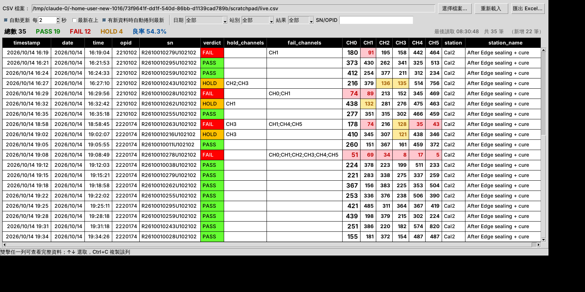

# 測試結果檢視器（operator_log.csv）

自動載入測試程式寫出的 `operator_log.csv`，持續偵測檔案變動，把新寫入的結果整理成固定格式表格：

`timestamp | date | time | opid | sn | verdict | hold_channels | fail_channels | CH0~CH5 | station | station_name`



## 功能
- **自動載入**：記住上次開的 CSV，下次開啟直接載入；也可用 `log_viewer.py <路徑>` 指定。
- **自動更新**：預設每 2 秒檢查檔案有沒有變動（看修改時間和檔案大小），有變動就重新讀取。測試程式寫到一半的行會先跳過。檔案被鎖住時，下一輪會自動再試。
- **時間排序**：`2026/10/14` 和 `2026-10-14` 兩種日期格式都能讀，統一顯示成 `YYYY/MM/DD`，再依時間排序。可勾選「最新在上」。
- **有新資料時自動捲到最新的一筆**，同時發出提示音，並顯示「新增 N 筆」。
- **上色**：
  - verdict：PASS 綠、FAIL 紅、HOLD 黃
  - CH 欄顯示 `ch_contrast`：fail 通道淺紅底紅字、hold 通道淺黃底褐字
  - **同站重覆測試**：同一站別（Cal1、Cal2…）裡同一個 SN 出現 2 次以上，SN 欄會標成紫色。上方顯示重覆的 SN 數和筆數，可勾選「只看重覆測試」；詳細資料會顯示這是第幾次測試。
  - 要改顏色，請修改程式開頭的 `COLORS`
- **篩選和統計**（所有條件同時成立）：
  - **日期下拉選單可打勾多選**：點日期下拉，每個日期前面有勾選框，可不連續勾選多天（例如只看 10/14 和 10/16），每勾一個就立即套用。
  - 時間區間（起～迄）：輸入 `HH:MM`，或含日期的 `2026/10/14 15:50`，可跨天。只填開始就列出之後全部，只填結束就列出之前全部。只有時間沒有日期時，會自動補上日期（複製來源那一列的日期；或已勾選的日期；或資料中最新的一天），並顯示在欄位裡。
  - 站別、結果、SN、OPID 各自獨立，可以組合使用。OPID 可以從下拉選單選（只列出資料裡有的 OPID，並會配合其他篩選條件），也可以手動輸入。
  - 「清除篩選」一鍵還原。上方即時顯示總數、PASS、FAIL、HOLD 和良率。
  - 雙擊儲存格會選取並複製內容，可貼到 SN 欄位篩選；右鍵選單可以直接用此 SN、OPID 或日期篩選。
- **詳細資料**：雙擊任一列（或選取後按 Enter）會顯示各通道的 tof / contrast / cnr / noise / pkpk / baseline 和 notes 等完整欄位，並可一鍵開啟 `out_dir` 結果資料夾。
- **匯出**：把目前篩選的資料匯出成 Excel，格式和畫面相同（需要 `openpyxl`；沒有安裝時改匯出 CSV）。
- 用 Ctrl+C 複製選取的列（以 Tab 分隔，可直接貼進 Excel）。

## 直接使用 exe（免安裝 Python）
**⬇ 下載最新版：https://github.com/ltotokkimo-spec/new-1016/releases/latest**（點頁面下方 Assets 裡的 `TestLogViewer_v版本.exe`）

到 [`release/`](release/) 下載 `TestLogViewer_v版本.exe`，雙擊即可執行。版本號寫在 `log_viewer.py` 的 `APP_VERSION`，也會顯示在視窗標題。要重新打包時，到 GitHub Actions 的「Build TestLogViewer.exe」按 Run workflow，它會在 Windows 上打包並把 exe 存回分支。

## 用 Python 執行
只需要 Python 3.8 以上（內建 tkinter），不必另外安裝套件。
```
python log_viewer.py "C:\path\to\operator_log.csv"
```
或雙擊 `run.bat`。第一次執行若沒有指定檔案，會跳出選檔視窗。

## 打包成 exe（給產線電腦用）
```
pip install pyinstaller openpyxl
build_exe.bat
```
打包好的檔案在 `dist\TestLogViewer_v版本.exe`。設定會存在 exe 旁邊的 `log_viewer_settings.json`。
